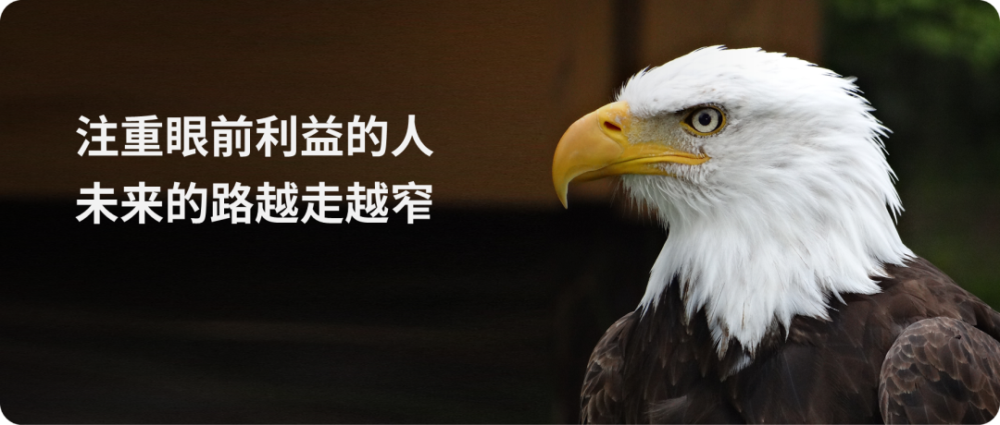
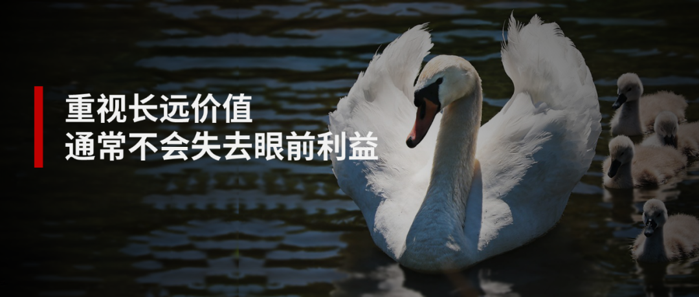
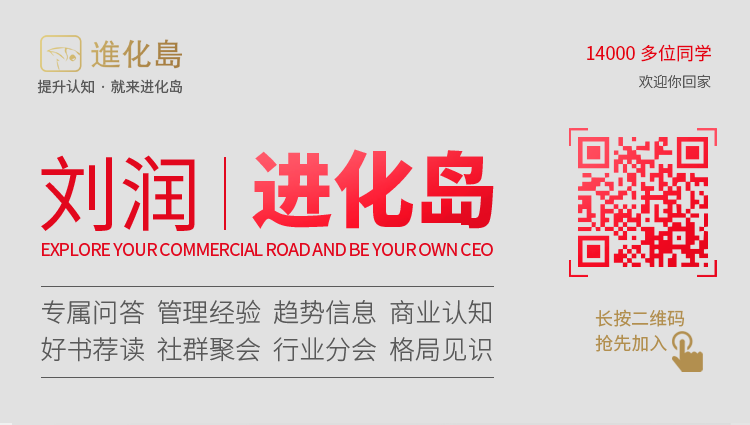

# 为什么顶尖高手，都是长期主义者？

> 作者：刘润  
> 公众号：刘润  
> 发布时间：2020-05-02 21:00  
> 原文链接：[微信原文](https://mp.weixin.qq.com/s/Skc5mF4-WtfkNssduNdb-g)  
> 保存日期：2026-11-16

---

蓝字关注，回复“1”抽取签名书

<strong>商业洞察</strong> 丨作者 / 刘 润   整理 /  万   青

这是<strong>刘润公众号</strong>的第<strong>811</strong>篇原创文章

真正聪明的人，都在做笨的事情。

---

## — 1 — 赚钱 从来都不是商业的起点

我经常喜欢说一句话：

<strong>一切商业的起点，都是消费者获益。</strong>

我们的学员，已经听了几百遍了，耳朵都磨破了。

但即便听了几百遍，我相信，还是会有一些同学表面点头称道、心里暗自嘀咕：

<strong>这种漂亮话，说说而已。</strong>

<strong>赚钱，才是商业的起点吧。</strong>

<strong>赚钱从来都不是商业的起点。赚钱是终点。</strong>

有很多明星喜欢开餐厅。

但常常是一开始门庭若市，稍微过一段时间就没人去了，然后亏损关门。

为什么？

粉丝喜爱明星，明星的影响力可以给餐厅带来“流量”。

哇，我一定要去试试，说不定还能要个签名呢。

可是尝过鲜之后，有些餐厅粉丝们再也不去第二次了。

为什么？因为菜品不好吃。

所以，这家餐厅没有“复购率”。

<strong>做餐厅，是流量更重要，还是复购率更重要？</strong>

<strong>当然是复购率。</strong>

餐厅开在一个固定的物理位置。

它只能服务附近几公里范围内的有限人群。

就算明星影响力再大，这个“有限人群”都来吃了第一次，但只要菜品不好吃，没有复购率，顾客最终会越来越少，直到关门。

<strong>让消费者获益，也就是把菜品做好吃，是一家餐厅的起点。</strong>

<strong>赚钱是自然而然的结果，是终点。</strong>

<strong>就这么简单？就这么简单。</strong>

天啊，这也听上去太显而易见了吧？

谁不知道把东西做好很重要啊？

是的。每个人都知道。

但是当你没有坚守长期主义，自己活下去都很困难的时候。

就会在消费者获益和自己获益之间，无比纠结，难以取舍。

<strong>大部分人不是不知道，而是做不到。</strong>

他们会问：我都要死了，还管消费者？

能在产品原材料上，偷工减料，就立刻克扣。

能多赚一分，绝不少赚一分。

这时候，坚守长期主义，就给了你巨大的战略定力。

有了“长期主义”护身符，就可以坚定地创造“客户价值”，从容地成长为巨人。

关于长期主义，冯仑先生举过一个特别生动的例子：

> 一个油饼五毛钱成本，卖两块钱，能挣一块五。
>
> 一个人把钱看得很绝对，认为多就是多，少就是少，钱很重要，所以觉得五毛钱成本太高，那能不能用地沟油？
>
> 成本三毛钱就行。蚂蚱也是肉，为什么不吃？多挣两毛钱也好啊。
>
> 于是，这个炸油饼的人就会面少一点、油也差一点。
>
> 但是可能又来了一个大妈，她觉得还是要让人吃了身体健康。
>
> 她的心思在健康上，没在钱上，她就用品质最好的油、最好的面。
>
> 同时还考虑别人拿饼的时候别烫手，再在拿油饼的这张纸上面写几个字，提醒注意烫。
>
> 她心中有别人，结果别人都知道她们家的油饼是健康的，服务是贴心的，她们家门口的排队越排越长，那家就不好了。

<strong>注重眼前利益的人，拼命压榨“价值空间”，一点“价值空间”都不想留给对方。</strong>

<strong>注重长期主义的人，拼命退让“价值空间”，想要“价值空间”最大化留给对方。</strong>

<strong>注重眼前利益的人，一时赚得盘满钵满，未来路却越走越窄。</strong>

<strong>注重长期主义的人，一时利润不尽人意， 未来路却越走越宽。</strong>

---

## — 2 — 重视长远价值 通常不会失去眼前利益

有一次，<strong>进化岛</strong>上的同学问我：<strong>润总，我如何才能像华为一样成功？</strong>

我说，我对华为的了解很浅薄。

但据我所知，华为的成功，是和以下几点分不开的：

1）只占公司1%股份的任正非，用梦想和利益团结了一大批员工；

2）然后共同选择了一条长长的、厚厚的、湿湿的雪道；

3）开始艰难地推动雪球，并坚持把每年收入的10%投入研发，滚大雪球；

4）他们就这样艰苦地推动了32年，以奋斗者为本，以用户为中心；

5）然后上天决定，在上百个关键时刻，都撒上了一些运气；

6）最终，这个团队走到了今天。这位同学一听，皱起眉头。非要推动32年吗？

这个时代，有更有效的办法吧？

小米不是创业9年，就成为了世界500强吗？

我说，我对小米也了解一点。据我所知，小米的创业，其实不止9年。

1）1992到2007年，雷军做金山软件，积累了16年的软件经验；

2）2007到2010年，雷军做天使投资，积累了3年的资本经验；

3）2010到2019年，雷军做小米科技。虽然只有9年，但他每天睡4-5小时，被称为劳模；

4）小米的成功，你看上去是9年的薄发，但却是即便勤奋如雷军，也必须经历的30多年的厚积。

他说：可是，那马云呢 ？马云就说自己不勤奋，但是马云不是更成功吗？勤奋，不如选择重要吧…

听到这里，我们有必要停下来，重新审视他最开始的问题。

<strong>华为成功的路径他嫌长，小米成功的路径他嫌累。</strong>

<strong>他想要的，其实不是成功的“路径”，而是成功的“结果”。</strong>

<strong>看到成功的人、成功的企业，我们羡慕，我们迫不及待的想要学习。</strong>

就像很多人都想学巴菲特的价值投资。

但如果我告诉你，价值投资，让巴菲特在50岁以后，赚到了人生99.8%的财富。

估计很多人可能立刻就会问：啊？要等到50岁啊？能不能早一点啊？

等到50岁，已经没有青春去挥霍财富了呢！

<strong>很多人都想“复制”他99.8%的财富这个“结果”。</strong>

<strong>而不是“学习”他从10岁到50岁这一路走来的“过程”。</strong>

甚至连这个过程之中，是否果断放弃眼前的丰厚利益，内心都要犹豫煎熬。

牺牲眼前到手的利益，去换取未来更长远的利益，这种抉择往往极为痛苦。

因为眼前的利益，所有人都看得到，长远的利益却很难看到。

<strong>重视长远价值，通常不会失去眼前利益。</strong>

<strong>仅仅重视眼前利益，则往往会失去长远价值。</strong>

---

## — 3 — 只有客户成功，我们才能成功

关于长期主义，让我想起一次我邀请前阿里巴巴总裁卫哲到我的企业家私董会做的分享。

卫哲说的一段话很触动我。

> 他说：你们都说客户至上，但是你们开会讨论什么问题？看什么报表？资产负债表？损益表？现金流量表？这三张表代表谁的利益？都只代表股东的利益。你们开会时只讨论股东利益，凭什么说客户至上？

听完这段话，我当时一震。

是啊，很多公司都在说客户至上，但是开会看“客户报表”吗？

你每周，或者每个月，看客户有没有因为你而赚钱了吗？

看客户因为你而少花钱了吗？

看客户因为你而拿到投资、甚至上市了吗？

卫哲给我分享了一个故事。

早期阿里巴巴的主营业务，是通过互联网，帮助中国供应商对接海外买家。

也就是所谓B2B国际电商。

他们有支强大的地推团队，被称为“中供铁军”，就是做这件事的。

有一次，卫哲检查工作时发现，有一个“铁军”卖了20万的B2B国际电商服务，给一家中国本土的房地产公司。

卫哲一看就知道，这个销售一定是用了所谓“把梳子卖给和尚”的技巧，卖给了客户一个根本就不需要的服务，从而完成自己的业绩。

这时候怎么办？把销售骂一顿，然后说下不为例？很多人估计都会这么做。

这么做，就不是阿里了。

阿里怎么做？

阿里把这名销售开除了。<strong>然后把20万，退给了客户。真的退了。</strong>

<strong>进了口袋的钱退出去，是很不容易的。</strong>

但是，阿里是希望大家知道：

<strong>只有客户成功，我们才能成功。</strong>

<strong>否则，这个钱不是赚来的，是骗来的。</strong>

---

## 最后的话

在进化岛上，我曾经分享过对于聪明人的看法：

有一次和晨兴资本的刘芹聊天。

聊到一个项目。他说早期就不太看好，

为什么？

因为这个创始人太聪明了。

什么意思？太聪明也不对吗？

聪是听力好，明是视力好。

太聪明，每天都能看到各种机遇，接触更多资源，想到各种激动人心的模式。

因此，他们常常受不了诱惑，不断拣了芝麻，丢了西瓜。

在红利和风口间上下起伏，非常容易失焦，非常容易患得患失。

<strong>而创业呢？</strong>

<strong>是把一件事坚持做到极致。</strong>

<strong>一定程度的“傻”，有助于这种坚持。</strong>

其实，可以看到全世界，听到全世界，有时是一种惩罚。

太聪明的人，需要对抗全世界。

我说，那不是真正聪明的人。

<strong>真正聪明的人，都在做笨的事情。</strong>

真正聪明的人，他们不断在问“这件事情的本质是什么”，“那件事情的逻辑是什么”。

<strong>真正聪明的人，都会坚守长期主义。</strong>

然后坚定地创造客户价值，给合作伙伴，给消费者，留出足够的“价值空间”。

<strong>在商业战场上，什么样的竞争对手最可怕？</strong>

<strong>认真坚守长期主义的人，而不是聪明的人。</strong>

---

推荐阅读：

<strong>[在北上广深，有房有车的中年男女最好“欺负”](http://mp.weixin.qq.com/s?__biz=MjM5NjM5MjQ4MQ==&mid=2651621626&idx=1&sn=819615f8b7cd70aff365f2071944caa1&chksm=bd11d3b48a665aa243d6abce00c5b46b9ed9fe60ad2cf6e462be59fff398285a93ef83d9b587&scene=21#wechat_redirect)</strong>

---

花半秒钟就看透事物本质的人，  
  和花一辈子都看不清的人，  
  注定是截然不同的命运。

<strong>长按二维码关注</strong><strong>，一起洞察商业本质</strong>

<strong>▲ 长按关注刘润，洞察商业本质</strong>

<strong>商业咨询</strong> | <strong>培训合作</strong> | <strong>案例撰写</strong> | <strong>转载开白</strong>

请在公众号后台回复  <strong>合作</strong>

2010年，全球最有钱的388人，他们拥有的财富，相当于全球一半贫穷人口拥有的财富总和；2014年，这个数字是85人，2015年，62人。2017年，只有8个人。也就是说，一辆商务车，就能装下全球一半贫穷人口的财富。

<strong>商业认知的不对称，带来机会的不平等。</strong>你必须培养自己敏锐的商业认知，才有可能在机会到来时一把抓住。<strong>每个人，都至少有一次机会。</strong>为此，我为所有想要提升商业认知、跟上时代变化的朋友们，<strong>建立了一个属于我们自己的社群“进化岛”。</strong>

<strong>长按识别下方二维码，</strong><strong>和 14000 多位岛民成为人生私董会、商业私董会朋友， 加入qq群，交换资源技术，升级认知，互助解决人生困惑，商业实际问题。</strong>

每个人都是自己的CEO，和我一起，抓住趋势，把别人的顿悟，变成你的基本功。

---
