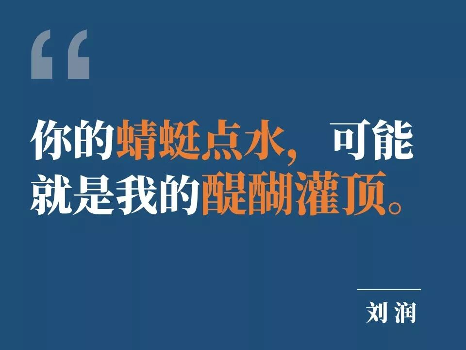
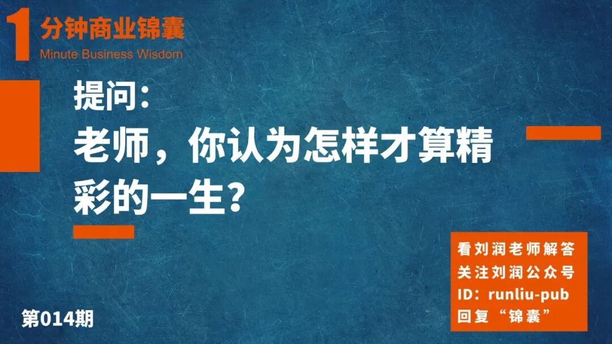

# 刘润：为28万学员写了100万字，我从《5分钟商学院》学到的3件事

> 作者：刘润  
> 公众号：刘润  
> 发布时间：2018-10-12 22:02  
> 原文链接：[微信原文](https://mp.weixin.qq.com/s/ivNiuNATHr-d_zqK0UOqJg)  
> 原文“阅读原文”入口：[刘润社群](https://wx.zsxq.com/mweb/views/joingroup/join_group.html?group_id=518181148814&secret=3ioisp0hfsd1l0ulmptdea49gse0xjn1&user_id=825228551452&invite_time=2017-10-27T08:29:17.000+0800)  
> 保存日期：2026-11-16

---

2013年，离开工作近14年的微软，我问一位前同事：你当时离开的时候，是什么感受？

他说：

> 没什么感受，直到第二天早上。你刷完牙，洗完脸，吃完早饭，收拾好自己，准备去上班时，突然发现，自己再也不需要去那个去了十几年的地方上班了。<strong>一种强烈的伤心，突然袭来。</strong>
>
> 你从梦中突然醒来：我居然真的离开了。

就是这种感觉。

<strong>这是我第二次有这种感觉：《5分钟商学院》，居然真的结束了。</strong>

《5分钟商学院》的全名，叫《刘润 · 5分钟商学院》。

为什么？

2016年，我第一次和罗胖沟通这个产品原型时，他说：你必须把自己的名字，加在产品前面。这是招牌。<strong>这样，爱惜羽毛如生命的你，才绝不会敷衍。你丢不起这个人。</strong>

我为罗胖的这个小心思一惊。

果然，我发现我丢不起这个人。2年后的今天，我以我之名，居然为28万的付费学员，整理了超过1000万字的素材，交付了超过100万字的2季课程。

录制了超过600篇语音，做了10场线上直播，20场线下大课，4次海外游学，请了50多位客座教授驻场，甚至发放了20万元的奖学金。

这2年，很多5商学员对我说，他们获得了不小的收获。真好。祝贺你们。

但是，<strong>其实有一个人，他这2年悄悄获得的收获，可能是远远超过所有28万学员的。</strong>这个人获得的成长，是他自己都不敢想象的。

这个人就是我自己。

没有做作，没有夸张。是真的。你很难想象，我的收获有多么巨大。我对此满怀感激。

今天，在5商两季课程正式结束之时，请允许我与你分享。

## 1 只有对普通人讲得清楚 才证明你想得明白

我以为自己挺会讲课的。

在2016年做《刘润 · 5分钟商学院》之前，我已经是有点影响力的咨询顾问，而且每年要给企业家、创业者、CEO讲100天的课。无数人听完我的分享，会冲过来对我说：

> 润总，这是我这辈子听过的最好的课。

今天想来，只能呵呵了。<strong>那是因为，你没有对28万人讲过课。</strong>

当我把第一个“5分钟”音频交给罗胖的时候，罗胖当时的“克制”我至今印象深刻。我能敏锐地体会到，他在努力挑选合适的词，在不伤害我前提下，表达他的不满。

但是显然，他失败了。他没找到这样的词汇。于是，直接劈头盖脸。

我哪受过这样的批评。但可气的是，他讲得有道理。

然后，我咬着牙回去改。然后又被打回来。然后再改。<strong>就这样，我的第一个“5分钟”，一共改了50多稿。</strong>

在微软的时候，我的下属年薪百万。他们非常优秀，我们的知识结构也非常相似，所以，沟通非常容易。我们有一大片的共识区域。<strong>在共识区域里，你的蜻蜓点水，可能就是我的醍醐灌顶。</strong>

但是在5商的28万学员中，大家的知识结构，实在是差太远。把28万各行各业、各层各次的学员放在一起，<strong>我们的共识，就是没有共识。</strong>

这不是学员的问题，这是我自己的问题。我需要在几乎完全没有共识的情况下，把事情讲清楚。<strong>这就逼着我，想清楚那些我本来以为必然正确的东西，也就是共识。</strong>为什么正确是正确，共识是共识？

在重新证明共识的过程中，我发现，我对很多概念的理解，似是而非，知其然不知其所以然。我一身冷汗。

那一刻，我突然明白了，为什么很多知名教授讲不好课。很多教授很喜欢说，“等你水平到了，就会明白了”。这句话的本质，是对因为想不透、所以讲不清的自暴自弃。

<strong>只有对普通人讲得清楚，才证明你想得明白。</strong>

## 2 把自己逼疯，把对手逼死

在这2年中，《刘润 · 5分钟商学院》出现了很多的模仿者，有6分钟商学院，有7分钟商学院，还有各种五花八门的商学院。

我一开始，有些焦虑。去听了几个。后来发现，你根本就听不完。再后来，我就不听了。我明白，我真正应该关注的，不应该是竞争对手，更不应该是模仿者。<strong>我唯一应该关注的，是用户。</strong>

因为所有产品的失败，只可能是因为被用户抛弃，而不会是因为被竞争对手干掉。<strong>逼死竞争对手最好的方式，是把自己逼疯。</strong>

每一篇5分钟商学院的文章的生产流程，都是先从2万字左右的素材里，先整理出2、3千字的文章。为什么？保证文章的知识浓度。

然后，我再一个字一个字的删减到1800字的音频，保证音频是在5-6分钟左右。

为什么？因为一篇10分钟左右的音频，一周没听，就1个小时了。用户会压力巨大。两周没听，他就再也不会听了。而且，他不会觉得是自己的错。<strong>他会找到一个理由：是你讲得不好！然后删掉APP。</strong>

马克·吐温说：

> 抱歉，我没有时间给您写一封简短的信，所以我写了一封长信。

我花双倍的时间，就是为了节省学员的时间。

<strong>然后，我请专业的声音训练师，帮我练习字、词、句的发音，口播时的吐气、抑扬顿挫。</strong>学员是不是能听完，除了短，还取决对于是否移步换景，让注意力一直不涣散。充满吸引力的发音，是抓住注意力的手。

<strong>当然，文章的结构，也非常重要。</strong>看文章，和听语音最大的不同是，看文章你是可以回去再看一遍的，听语音你只能向前。所以，语音信息流中的逻辑瀑布，就显得非常重要。稍有跳跃，用户就会立刻跳悬崖而死，不知道你在说什么。

<strong>就这样，每篇5分钟的课程，不包括我的团队时间，我都要花5-7个小时。</strong>

我的产品经理宁志忠问我：润总，你有拖延症吗？

我说：我没有“拖延症”，我有“拖延就会死症”。

<strong>“拖延就会死症”，把我自己逼疯，把对手逼死。</strong>

## 3 当你心中没有自己的时候 才会有用户

2年的5商，我经历过4任“得到”的产品经理：李双宏，陈轶男，吕燕宜，和宁志忠。

这四任产品经理都有一个特征：特别谦虚。他们说话的姿势，通常是这样的。你们感受一下：

> 润总，您的这几节课写得太好了，转发率，是专栏里最高的之一，几乎完美。但是，如果一定要鸡蛋里挑骨头的话，他们的数据比你自己的平均值要低一些。我们觉得您写得非常好，但是如果您能从以下99个方面做提升，就更完美了。

一定是罗胖！一定是罗胖培训过他们！

我知道，我的考验来了。我实在是太爱这些文字了。谁都不能说它一个字的不好。我绞尽脑汁，删了写，写了删，再修改，再打磨。直到我觉得一个字都不能改为止，才敢发布。你们不知道我是如何斟词酌句写下每一个字的；你们完全不理解我的结构设计；你们哪懂我巧妙的前后呼应；你们 ……

…… <strong>我说：好的。我改。</strong>

两年前，我说我改的时候，我是压抑着自己一点点情绪的。两年过去了，我看到数据 …… <strong>数据不会撒谎，于是我亲手杀死自己的文字。</strong>心如止水。

改完后，我开始写一篇新专栏，丝毫不会因为以后有可能会改，就减少哪怕一分的心血。因为，我会再次疯狂爱上自己的文字。

我想，我终于能从心底克服了宜家效应，鸡蛋效应，沉没成本，和其他不管叫什么的心理。无论投入多少心血，都毫不手软。

我终于可以做到：<strong>既疯狂爱自己的文字，又能冷静地掐死它。</strong>

为什么？

用户最大的竞争对手是你自己。<strong>当你心中没有自己的时候，才会有用户。</strong>

## 4 商业的世界 不是人生的支线

《刘润 · 5分钟商学院》两季内容，终于完整交付了。

两季内容，我为28万学员，写了100万字课程。<strong>以上，就是我在写着100万字时，学到的东西，获得的感悟。</strong>

希望这些感悟，对你，对你的朋友，对所有正在做知识付费，打算做知识付费，或者所有做其他产品的同学，有一点点帮助和启发。

昨天和罗胖、脱不花一起吃饭。脱不花一句话很让我很受触动。<strong>她说：</strong><strong>我不希望，5商变成你人生的支线。</strong>

是的。

我是做咨询公司的。5商不是我做咨询生涯中，插进来的2年支线情节。我从5商中学习到的，是一生受益价值观；<strong>我在5商中结识的28万学员，也希望一生相伴。</strong>

在未来，我会持续在得到里，更新更多的“商业选修课”；在我的公号里，更新我更多的商业观察；在真实的商业世界中，与你并肩作战。

第二天早上。我刷完牙，洗完脸，吃完早饭，收拾好自己，坐在办公桌前写《5商》时，突然发现，自己再也不需要写这个写了700多天的课程了。<strong>我一点都没有伤心。因为我知道，你们都还在。</strong>

这是《刘润 · 5分钟商学院》陪你成长的又一天，期待你的进步。

<strong>PS：若您还没加入已经有28万学员的《刘润 · 5分钟商学院》，后台回复“商学院”，即可了解订阅。</strong>

<strong><strong>- End -</strong></strong>

<strong>关注刘润公众号：</strong>runliu-pub

<strong>看最近精彩内容☟</strong>

<strong>长按二维码立刻关注</strong>

<strong>每天为你梳理商业逻辑</strong>

一分钟商业锦囊

每天1分钟，梳理商业逻辑。这是《1分钟商业锦囊》陪伴你的第<strong>014</strong>天，期待你的进步。

本期问题：<strong>怎样才算精彩的一生？</strong>

公众号“刘润”（runliu-pub）会话框里，回复关键词“<strong>锦囊</strong>”，查看刘润老师的解答，培养你的商业认知。

注：当天有效，阅后即焚。点击<strong>阅读原文</strong>，加入已有6700+岛民的<strong>刘润社群</strong>。

<strong>▲关注公众号，回复“锦囊”，看刘润的解答</strong>
