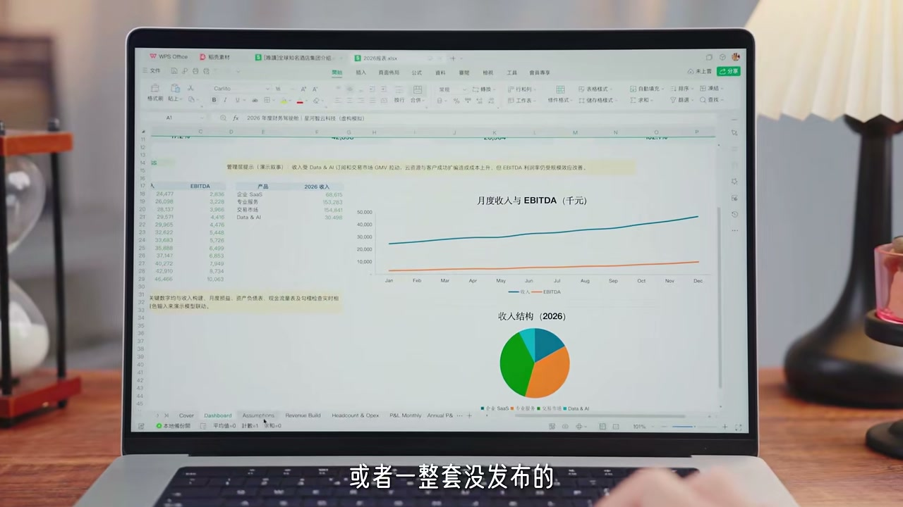
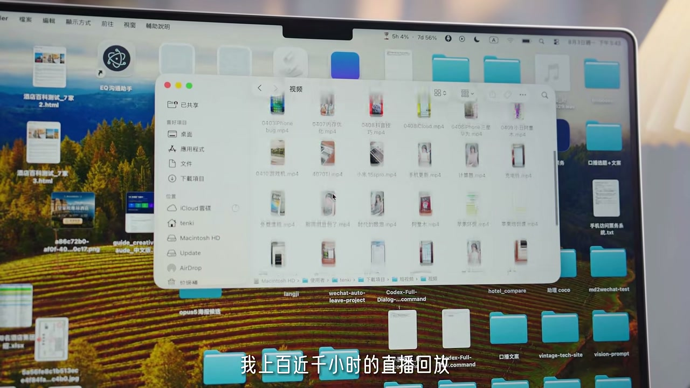
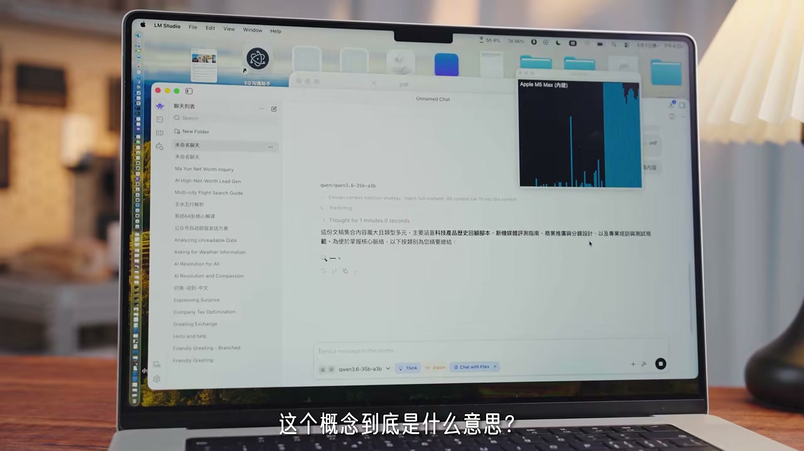
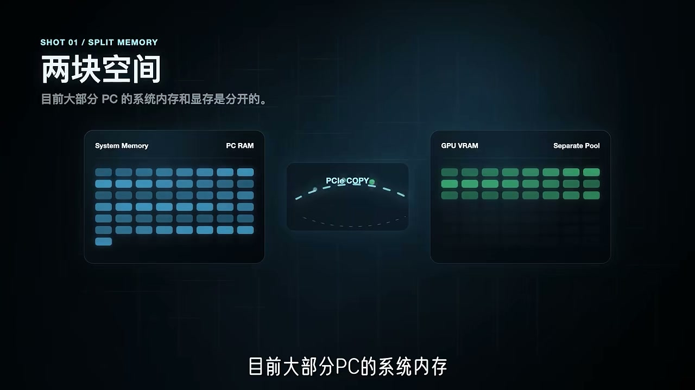
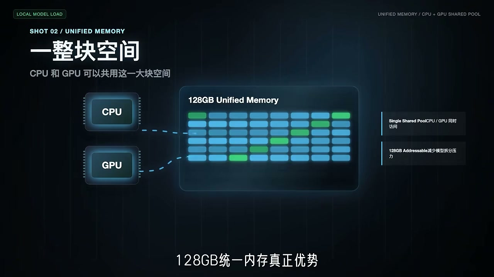
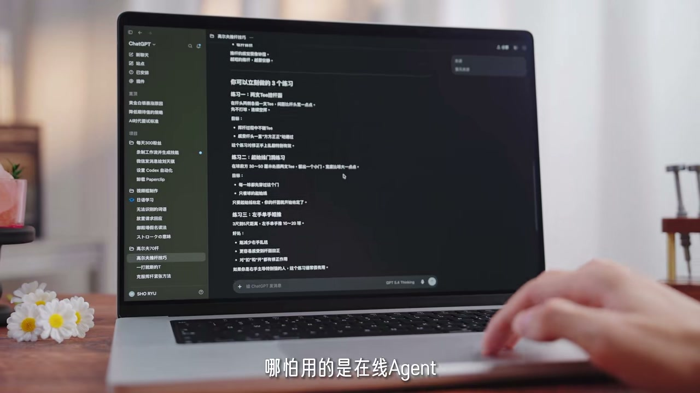
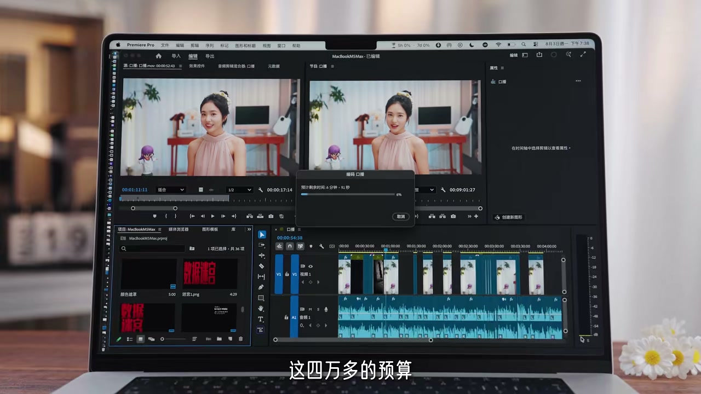

# 好的生产力工具，让想法先开始

*从本地 AI 到移动剪辑，重看一台电脑的价值*

原视频讲述：小西 / 小西设计所　｜　文章整理与页面设计：Brclio

电脑越来越快，真正影响生产力的，却常常是开始做一件事有多麻烦：资料要不要上传，旧文件能不能找回来，模型能不能在本机运行，离开桌面后能不能接着工作。

这篇文章沿着小西的一次实际使用分享，讨论一台电脑如何接住本地 AI、资料整理、在线 Agent 和移动剪辑这一整套需求。以下保留原视频的完整讲述；第一人称“我”均指小西，画面说明另行标明。

## 从“算了”到“那试试”

原视频时间：00:00–01:10

我最近老在琢磨一个问题：电脑性能一年比一年强，但到底什么样的电脑，才能算得上一台真正优秀的生产力工具呢？尤其是我们这种视频博主，一提到生产力，大家脑子估计都是在想：得，她又得说剪视频了。

确实，生产力这件事还真不只属于剪片子的人。做表的、写方案的、敲代码的、备课的、对账的、回一天消息的，大家干的活都不一样，但图的其实是同一件事：把活干完，少加会儿班。可你有没有发现，真正阻碍生产力提升的，可能不是手头上的工具能跑多快，而是它能不能让你少说几次那两个你特别熟悉的字？

图1 · 00:39｜红黑色数据走廊与障碍，表现开始行动前的繁琐步骤。原片标注为 AI 生成的视觉隐喻及情景再现。

算了。素材太多了，算了，不剪了；数据太乱了，算了，先放着。想做个小工具，但还得学代码，算了。脑子里突然冒出一个想法，可一想到还要搜资料、整理、一步步执行，最后还是算了。

但这个“算了”，很多时候还真不是我不行，是步骤太多、等待太久、启动成本太高。最后，手里的工具替我做了个决定。所以我越来越觉得，一个好的生产力工具，不应该只看它跑得有多快。更重要的是，它能不能把你那些“算了”，重新变成一句“那试试”。

画面补充：00:12–00:18 的示意图写着“生产力，不只属于剪片子的人”；00:18–00:29 切换到 M5 Max 产品拼贴和代码窗口。拼贴所写“最高 128GB”“最高 8TB SSD”是画面展示的配置范围。

## 一台顶配电脑的使用背景

原视频时间：01:10–01:36

这台 MacBook Pro M5 Max，128GB 顶配，我自费买来已经用了两个多月了。尤其在如今愈发强大的 AI Agent 开始真正介入工作流之后，我发现它能帮我捡回来的那些“算了”，也早就不只发生在剪视频这件事上。

所以这一期咱不讲参数，也不跑那些离普通人很远的分数。我把这一个多月里那些以前嫌麻烦、懒得做，甚至觉得自己做不到的事情，一件一件现场做给你看。

图2 · 01:15｜实机锁屏旁的订单卡显示实付款 41,124 元。此处对应作者自费购买与使用时长的介绍。

## 让敏感资料留在本机

原视频时间：01:36–02:34

先问你个问题吧，你有没有一些东西死活不敢丢给在线 AI？倒不是说干了什么见不得人的事，就是有些文件，它就该老老实实待在自己的电脑里。比如还没对外的会议录音、客户的财务报表，或者一整套没发布的内部资料。复制进对话框的前一秒，你的手一定会顿一下。

以前遇到这种情况，基本就一个解法：不用 AI，算了算了。而这台机器第一次让我把这个“算了”收了回来。因为它能在本地断网跑一个足够大的 AI 模型，文件从头到尾都不用离开这台电脑。

图3 · 01:51｜视频用 WPS 表格展示财务资料场景，屏幕包含“月度收入与 EBITDA（千元）”和“收入结构（2026）”图表。

最直观的就是会议录音，一两个小时的长会开完，还要整理纪要。我直接打开飞行模式，把录音扔进 MacWhisper，用本地模型转成文字。

图4 · 02:15｜MacWhisper 转写画面，窗口标题为“两小时音频文件”，界面所示音频总时长为 02:06:13。

虽然实测速度确实会快一半左右，但它赢的不是快，而是另外三样。不联网、不要钱，不用先把整场会议转到一台我不知道在哪的服务器上。毕竟普通采访可能无所谓，保密会议可就不好说了。

画面补充：转写窗口显示正在转录，并滚动呈现中文文本。上述“快一半左右”是作者口播中的体验表述，片中这一段没有给出完整对照条件。

## AI 找异常，人来核数字

原视频时间：02:34–03:23

而录音还只是声音，报表就更敏感了。做财务、月底对账的人最懂，表格越乱，你越想让 AI 帮忙。但里面那些收入、支出和客户数据，又最不敢往外发。

我把表格交给本地模型，让它帮我找异常、看趋势，把值得复核的地方挑出来。哪些数据波动反常，哪笔支出突然变大，哪些项目需要重点检查。

图5 · 02:57｜数据走廊中被标红的项目与单据，配合“找异常、挑出值得复核的地方”的叙述。这是视觉隐喻，不是真实账目截图。

但算账这件事，如今的大模型依然会算错，这个你别信它。所以它干的活是帮我划重点，挑出该注意的。到了具体数字，我自己还得一笔一笔核。它负责让我不漏看，我负责对数。

也正因为它全程在本地、不上云，我才敢把这张表交给它。如果换成在线 AI，这表格我可不敢发。

主持人：你敢发吗？

摄像：我敢啊。

主持人：你牛逼，摄像大哥你牛逼。

摄像：把你的发上去。

## 把积存资料变成可以提问的知识库

原视频时间：03:23–04:28

然后最戳我的还有一个，你电脑里是不是也躺着一摞这种东西？存了几十篇的 PDF，买了没看的几十个小时的课。我上百近千小时的直播回放，我都忘了我说过啥了。还有各种多得吓人的说明文档，摆在那儿，我这辈子大概率都读不完了。

真碰上一个问题，想查一句，翻半天也找不着在哪一页。过去这种基本也只能算了。而且这些东西，先不说有没有我不想往云端传的小秘密。就算没有，想象得到的费用和时间也少不了。

图6 · 03:33｜Finder 中保存着视频文件和资料，呼应 PDF、课程、直播回放和说明文档越积越多的场景。

现在我会把这些所有东西都喂给本地模型，让它先替我通读一遍。这台 MacBook Pro M5 Max 实现的效果又快又好。有了知识库和索引之后，哪句话看不懂，直接拿大白话问它。

这个概念到底是什么意思？这几篇文章里有没有提到某个结论？这个功能写在说明书的哪一页？

它会从这一堆资料里帮我找到相关内容，整理出来，然后再告诉我来自哪份文件。说白了，就是让它成为你身边的“明白人”。这一摞资料，它已经替你啃过了，往后你哪句不懂，张嘴问就行。

图7 · 04:09｜LM Studio 的本地文件问答界面；右上角叠有 Apple M5 Max 的性能窗口。原片在此展示资料检索和问答。

## 本地大模型首先要装得下

原视频时间：04:28–05:47

看到这里，可能有吴彦祖要问了：好用是好用，但这和硬件有什么关系？因为本地跑大模型，第一道门槛往往不是跑得快不快，而是装不装得下。

目前大部分 PC 的系统内存和显存是分开的，模型主要靠 GPU 跑，即便是 5090，算力很猛。但能完整装进 GPU 的模型，依然受 32GB 显存限制。一旦模型本身、上下文和运行占用超过这个容量，要么换小一档，要么就把一部分放进系统内存，速度和体验都会往下掉。

图8 · 04:39｜原片用“两块空间”说明 PC 系统内存与独立显存分开，并以 PCIe COPY 表示数据传递。

而我这台 MacBook Pro 的 128GB 统一内存，真正的优势就是 CPU 和 GPU 可以共用。这一大块空间，一些普通消费级独立显卡完整装不下的模型，反而能直接在这台机器上跑。

图9 · 05:03｜原片用“一整块空间”说明 CPU 和 GPU 共用 128GB 统一内存，是这段硬件解释的核心图示。

当然，真比同一个模型的生成速度，5090 会更快。但关键的是，这台电脑不光能装下更大、能力更强的模型，还能合上盖子，直接塞进背包。到了公司、酒店、高铁上，甚至断网的地方，打开就能继续跑。不插电也能继续工作，更不用拖着机箱、电源和独立显卡。

它相当于把过去需要一台大内存工作站才能干的事，塞进了一台可以随身带走的电脑里。那些原本因为模型太大、机器带不走、资料不敢上传，只能说“算了”的事情，它一台就接住了。

画面补充：04:44–04:49 的 RTX 5090 示意图标出 32GB GDDR7；05:08–05:13 则演示模型进入统一内存后开始本地推理。图中的 token 数字是动画元素。随后画面回到打开笔记本和使用聊天界面的实拍。

## 在线 Agent 也需要合适的工作环境

原视频时间：05:47–06:57

而且这套优势，还不只发生在本地模型上。哪怕用的是在线 Agent，我这段时间也明显感觉到，在 Mac 上干活往往更少走弯路。当然，不是 M5 让云端的 AI 突然变聪明了，而是 macOS 给它的工作环境相对更统一。

图10 · 05:51｜笔记本上的 ChatGPT 界面。该段配合在线 Agent 的讨论，画面内容包含建议和资料整理结果。

找文件、批量改名、整理素材、安装工具，这些事情它可以直接通过 Shell，也就是系统里的命令行来完成。需要操作软件时，又可以调用快捷指令或者 AppleScript。你可以把它理解成 Mac 自带的自动化遥控器。这样 Agent 就不用每走一步，都得重新截图、找按钮、模拟鼠标点一下。

Windows 当然也能做，它有 PowerShell，也可以通过 WSL 运行 Linux 工具。但目前在我的这些任务里，Windows 环境的组合通常更多。Agent 有时候得先判断软件装在哪、路径怎么写、权限怎么开，到底该走哪套环境。每多判断一次、多报一次错、多返工一次，就会多一轮理解和执行。

图11 · 06:39｜Windows 上的 Codex 环境体检摘要，画面显示耗时 11 分 21 秒，并列出重复安装、PATH 冲突和部分工具不可用等情况。

Mac 的优势就是能更容易找到一条短而确定的路，少猜一次、少试一次、少重来一次。省下来的就不只是时间，还有你真金白银买来的 token。

图12 · 06:57｜macOS 上的环境体检结果，画面显示耗时 6 分 59 秒；同样列有 Docker 缺失、版本抢占和 PATH 等问题。

画面补充：两张体检截图展示的是两次具体任务和各自的安装环境。它们都报告了环境问题；原片未展示控制变量齐全的系统性能测试。前面的聊天画面还出现高尔夫练习建议，以及 ColdFusion、Wendover Productions、AI Explained、Matt Wolfe、Two Minute Papers 等频道资料。

## 把剪辑工作带离桌面

原视频时间：06:57–08:04

最后再说回咱们最熟悉的剪视频。你现在看到的这条片子，从剪辑、调色到最后导出，全部都是在这台 MacBook Pro 上完成的。

可能很多人觉得，这四万多的预算，拿去配一台顶级 PC，渲染速度肯定能把它甩开。但至少我在日常使用的 H.265 工作流里，还真不是那么回事。实际用下来，同价位的高性能台式机并没有跟它拉开多大差距。在部分软件和设置下，这台 Mac 甚至还可能更快。

图13 · 07:09｜Premiere Pro 的多轨剪辑时间线、预览窗口与导出状态。此处展示的是作者自己的视频制作工作流。

而且真正拉开差距的，还有导出之外的部分。台式机性能再强，也只能留在桌子上。现在我可以口播拍完，现场直接粗剪，回去的路上继续调色。回到家里或酒店，打开电脑接着导出。不插电，性能也不会突然掉一大截。

并且在剪辑和导出已经能追上大部分高性能台式机的情况下，还能把 128GB 统一内存、本地 AI、在线 Agent、断网工作和离电续航，全部装进一个背包里。

这也是为什么我最后花了四万一千多，买了这台 MacBook Pro 顶配回来。啥？你问高性能 Windows 笔记本？你是认真的吗？

画面补充：07:00–07:54 多次切回笔记本上的剪辑与导出实拍，时间线含口播、示意动画和音轨。原片保留了“日常使用的 H.265 工作流”“部分软件和设置下”等比较前提。

## 什么样的人需要这套配置

原视频时间：08:04–08:54

简单给一些购买建议。如果你只剪视频，不跑大型本地模型，低一档配置也完全够用。

如果机器常年固定在工作室，只追求极限速度，同样预算买台式机或者 Mac Studio 可能会更值。

但如果你的工作方式和我一样，既要剪片子，又要跑本地 AI，既要处理敏感资料，又不能被固定在一张桌子前，今天在公司，明天去客户那儿，后天可能就在飞机、高铁上继续干活，这可能是目前少数能把我这一整套需求同时接住的选择。

图14 · 08:33｜片尾的合盖机身特写。此前还展示了机身侧边接口，配合随身携带和移动工作的论述。

因为到今天，生产力早就不只是某一项性能了，是能把一整套工作方式随时带在身上。

这一个多月用下来，我对“生产力工具”这几个字，反而有了一个更简单的判断。

当你脑子里突然冒出一个想法时，手里的工具不会先替你说“算了”。它会让你觉得：那先试试。

片尾画面：主持人镜头加上浅蓝边框与制作名单。署名为“小西设计所 / seeou Design”；主演：小西；编导：刘导；摄像：王卷卷；剪辑：三水、与海。

## 来源与整理说明

本文依据用户提供的原视频整理。原片时长 08:53.538，画面尺寸 1280×720；口播与画面字幕经交叉核对，整理了标点、断句、明显识别错字和英文术语。产品型号、价格、性能比较与选购意见均作为原视频内容保留。

原片使用时长的表述存在差异：01:15 字幕写“已经用两个多月了”，01:30 与 08:40 字幕写“一个多月”；后两处语音识别初稿为“两个多月”。文章依画面字幕分别保留，未自行统一。

文中 14 张插图均直接截取原片，保留原有字幕和完整画幅，未重绘或去除标记。图注中的时刻是实际截帧位置，章节时间用于定位；段落时间与字幕切换可能相差约一秒。AI 生成的视觉隐喻已在图注中标明。

原片片尾署名：小西设计所 / seeou Design；主演：小西；编导：刘导；摄像：王卷卷；剪辑：三水、与海。

原视频文件：贵是真的贵呀，还好买的早~_这几个月用下来，让我对“生产力工具”这五个字，_有了一个更简单的判断。_当你脑子里突然冒出一个想法时，_手里的工具不会先替你说——算_20261.mp4

需要逐段回看时，可使用[完整口播时间对照](02_完整口播_时间对照.txt)；更多画面定位见[画面时间线与插图索引](04_画面时间线与插图索引.md)。

文章整理与页面设计：**Brclio**。设计采用 [Brclio Design System](https://github.com/Brclio/brclio-design-system)，按 [CC BY-NC-SA 4.0](https://creativecommons.org/licenses/by-nc-sa/4.0/) 署名、非商业性使用并以相同方式共享。该设计许可不覆盖原视频文案与截图；原视频内容及图片权利归原权利人。
